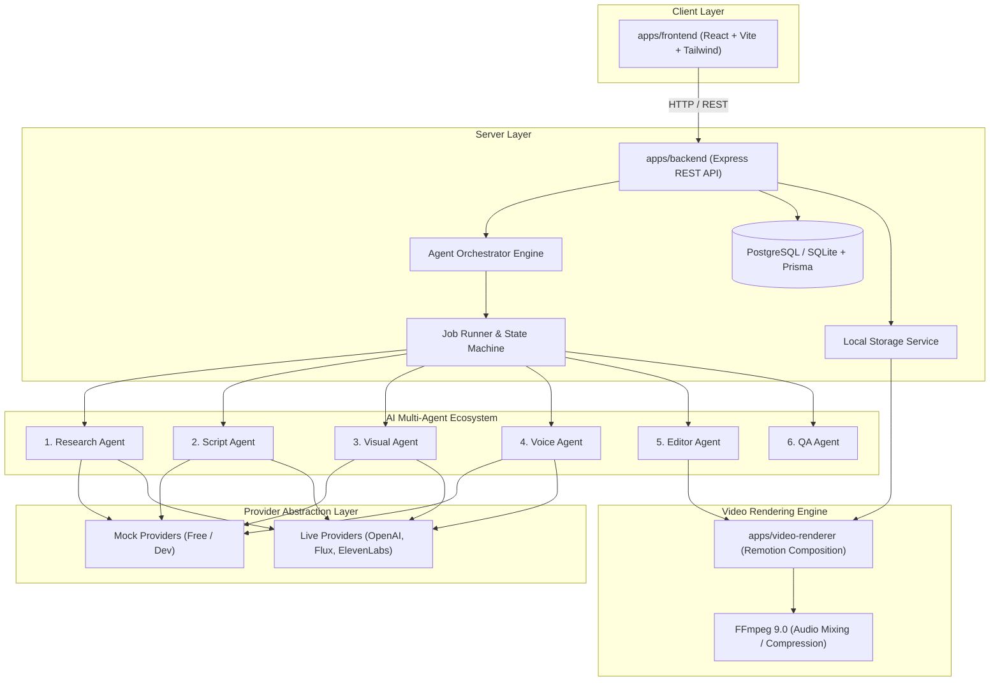
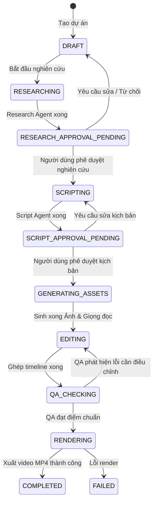

# VietSu AI Studio - System Architecture (ARCHITECTURE.md)

## 1. Tổng quan hệ thống
VietSu AI Studio được tổ chức theo mô hình **Monorepo** chia tầng rõ ràng, phân tách giữa giao diện điều khiển (Frontend), máy chủ điều phối & lưu trữ (Backend), lõi sinh video (Video Renderer), và các gói dùng chung (Shared Schemas & AI Provider Abstraction).



---

## 2. Cấu trúc thư mục Monorepo

```
vietsu-ai-studio/
├── apps/
│   ├── frontend/             # Giao diện Dashboard (React, Vite, Tailwind CSS, Lucide icons)
│   │   ├── src/
│   │   │   ├── components/   # Timeline, ProjectCard, PipelineVisualizer, VideoPreview
│   │   │   ├── pages/        # Dashboard, ProjectDetail, CreateProject, Settings
│   │   │   └── services/     # API Client gọi Backend
│   ├── backend/              # Node.js + Express + Prisma + Agent Orchestrator
│   │   ├── src/
│   │   │   ├── controllers/  # Projects, Jobs, Assets, Render
│   │   │   ├── orchestrator/ # Multi-Agent Workflow Engine & Job State Machine
│   │   │   ├── agents/       # Research, Script, Visual, Voice, Editor, QA
│   │   │   ├── routes/       # REST Endpoints
│   │   │   └── storage/      # Quản lý file hệ thống (assets, audio, videos)
│   │   └── prisma/           # schema.prisma & migrations
│   └── video-renderer/       # Remotion React Project (1080x1920, 30fps)
│       └── src/
│           ├── Root.tsx       # Remotion Root & Compositions
│           ├── VietSuReel.tsx # Main 9:16 Video Composition
│           ├── components/   # Subtitles, KenBurnsImage, HistoricalBadge, ProgressAudio
│           └── render.ts     # Script gọi @remotion/renderer để xuất file MP4
├── packages/
│   ├── shared/               # TypeScript interfaces, Zod schemas, Project DTOs
│   │   └── src/
│   │       ├── types/        # Project, Scene, Job, Cost, Agent types
│   │       └── schemas/      # Zod validation schemas
│   └── ai-providers/         # AI Provider Interfaces & Implementations
│       └── src/
│           ├── interfaces/   # ILLMProvider, ITTSProvider, IImageProvider, IVideoProvider
│           ├── mock/         # MockLLM, MockTTS, MockImage, MockVideo
│           └── registry.ts   # Factory & Provider Registry
├── storage/                  # Thư mục lưu trữ tài nguyên cục bộ
│   ├── assets/               # Hình ảnh, bản đồ
│   ├── audio/                # Giọng thuyết minh, nhạc nền BGM
│   └── videos/               # Video MP4 thành phẩm đã render
└── docs/                     # Tài liệu kỹ thuật
```

---

## 3. Kiến trúc Đa Agent (Multi-Agent Architecture)

Mỗi Agent hoạt động như một đơn vị xử lý độc lập có hợp đồng giao tiếp (Contract) được kiểm định nghiêm ngặt bằng **Zod Schema**:

### 3.1. Research Agent
- **Đầu vào**: `topic` (string), `targetDurationSec` (30 - 60).
- **Trách nhiệm**:
  - Truy vấn kho dữ liệu lịch sử chuẩn hóa.
  - Phân loại dữ kiện thành 3 cấp độ: `CONFIRMED_FACT` (Chính sử), `HISTORICAL_HYPOTHESIS` (Giả thuyết khoa học), `FOLKLORE_LEGEND` (Truyền thuyết).
  - Trích dẫn nguồn sử học chính xác (Tác phẩm, Quyển, Chương, Trang).
- **Đầu ra**: `ResearchDossier` (bản thẩm định sự kiện, mốc thời gian, nhân vật, bối cảnh văn hóa).

### 3.2. Script Agent
- **Đầu vào**: `ResearchDossier`.
- **Trách nhiệm**:
  - Tạo cốt truyện kịch tính tuân thủ cấu trúc 3 hồi (Hook, Escalation, Climax & Lesson).
  - Khống chế số từ (tối đa ~130 từ cho video 50 giây để giọng đọc tiếng Việt rõ ràng, tốc độ ~2.6 từ/giây).
  - Phân rã thành danh sách 4–8 `SceneDraft`.
- **Đầu ra**: `ScriptDocument` (Toàn văn kịch bản + mảng các phân cảnh kèm mô tả trực quan sơ bộ).

### 3.3. Visual Agent
- **Đầu vào**: `SceneDraft[]`.
- **Trách nhiệm**:
  - Viết Visual Prompt chi tiết cho từng cảnh: trang phục chuẩn thời kỳ (Lý, Trần, Lê, Nguyễn), bối cảnh địa lý (sông Bạch Đằng, Ải Chi Lăng, Cố đô Hoa Lư).
  - Sinh hình ảnh tỷ lệ 9:16 (1080×1920) hoặc bản đồ chuyển động quân sự.
  - Chọn kiểu chuyển động camera: `ZOOM_IN`, `ZOOM_OUT`, `PAN_LEFT`, `PAN_RIGHT`.
- **Đầu ra**: Danh sách `VisualAsset` (URL/đường dẫn file ảnh, kích thước, prompt, motion config).

### 3.4. Voice Agent
- **Đầu vào**: `SceneDraft[]`.
- **Trách nhiệm**:
  - Chuyển đổi văn bản thuyết minh tiếng Việt thành tệp âm thanh (TTS).
  - Tính toán độ dài chính xác từng câu và sinh bảng **Word-level Timestamps** (bắt đầu, kết thúc của từng từ đơn).
- **Đầu ra**: Danh sách `VoiceTrack` (Tệp âm thanh WAV/MP3 cho từng cảnh hoặc gộp, kèm mảng `WordTimestamp[]`).

### 3.5. Editor Agent
- **Đầu vào**: `VisualAsset[]`, `VoiceTrack[]`, `ScriptDocument`, `ResearchDossier`.
- **Trách nhiệm**:
  - Đồng bộ khung hình (Frame sync): Ánh xạ thời lượng âm thanh sang số frame Remotion (ở 30fps).
  - Ghép phụ đề động theo từ với hiệu ứng highlight màu vàng kim / đỏ sử thi.
  - Chèn huy hiệu chứng thực nguồn sử học (Historical Source Watermark) góc trên.
  - Tạo cấu hình `RemotionCompositionProps`.
- **Đầu ra**: `CompositionTimeline` sẵn sàng cho Render Engine.

### 3.6. QA Agent
- **Đầu vào**: `CompositionTimeline`.
- **Trách nhiệm**:
  - Kiểm tra độ lệch âm thanh/hình ảnh: Không cảnh nào bị tràn thời gian hoặc tắt tiếng bất ngờ.
  - Kiểm tra vùng an toàn Facebook Reels: Phụ đề nằm trong khoảng Y: 1100px - 1500px, không bị che bởi UI Facebook.
  - Kiểm tra tính xác thực nguồn: Mọi dữ kiện quan trọng trong kịch bản đều có citation tương ứng.
  - Trả về `qaScore` (0-100) và danh sách cảnh báo `warnings[]`.

---

## 4. Máy trạng thái Dự án & Vòng đời Job (Project & Job Lifecycle)



### Các trạm dừng phê duyệt (Approval Gates)
- **Cổng 1 (Research Gate)**: Xác minh sử liệu trước khi viết kịch bản.
- **Cổng 2 (Script Gate)**: Đọc duyệt toàn bộ lời thoại, phân cảnh, chi phí ước tính trước khi kích hoạt sinh ảnh AI và thuyết minh TTS (những bước tốn tiền nhất).

---

## 5. Mô hình Dữ liệu (Prisma Database Schema)

Các bảng chính:
- `Project`: Đại diện cho một video dự án (tên chủ đề, thời đại lịch sử, trạng thái, cấu hình).
- `ResearchItem`: Dữ kiện lịch sử trích xuất, mức độ xác tín, nguồn tham khảo (Sách, Tác giả, Quyển).
- `Script`: Kịch bản hoàn chỉnh của dự án, số từ, thời lượng ước tính.
- `Scene`: Từng phân cảnh chi tiết (thứ tự, lời thuyết minh, thời lượng tính theo frame, visual prompt, motion).
- `Asset`: Quản lý tài nguyên media (hình ảnh, audio thuyết minh, video render, dung lượng, mime-type).
- `Job`: Tiến trình xử lý nền (loại job, trạng thái, tiến độ %, logs, thời gian bắt đầu/kết thúc).
- `CostLog`: Ghi nhận chi phí cho từng tác vụ API (nhà cung cấp, loại dịch vụ, số token/giây audio, chi phí quy đổi USD/VND).

---

## 6. Lớp trừu tượng hóa AI Provider (Provider Abstraction)

Các Provider được định nghĩa theo Interface:
- `ILLMProvider`: `research(topic, era): Promise<ResearchOutput>`, `generateScript(research): Promise<ScriptOutput>`
- `IImageProvider`: `generateImage(prompt, options): Promise<ImageAsset>`
- `ITTSProvider`: `synthesize(text, voiceOptions): Promise<TTSOutput>` (trả về audio buffer + word timestamps)
- `IVideoProvider`: (Tùy chọn) `animateImage(imagePath, prompt): Promise<VideoAsset>`

Mỗi interface đều có:
1. **Mock Implementation**: Sử dụng dữ liệu mẫu lịch sử chân thực, tạo placeholder visual canvas/SVG chất lượng cao, sinh âm thanh thuyết minh mẫu và timestamps chuẩn xác. Chạy offline 100%, không cần kết nối mạng hay API key.
2. **Live Implementation**: Kết nối qua API key được cấu hình an toàn từ biến môi trường (`.env`).

---

## 7. Kiến trúc Render Video bằng Remotion
- **Khung hình chuẩn**: Chiều rộng 1080px, chiều cao 1920px (Tỷ lệ 9:16).
- **Tốc độ khung hình (FPS)**: 30 fps.
- **Thành phần hiển thị (Layers)**:
  1. *Background Visual Layer*: Hình ảnh minh họa với hiệu ứng Ken Burns (tự động tính toán scale từ 1.0 -> 1.15 hoặc pan nhẹ qua thời gian cảnh).
  2. *Historical Citation Badge*: Huy hiệu góc trên bên trái hiển thị trích dẫn nguồn (ví dụ: *Đại Việt Sử Ký Toàn Thư - Bản kỷ toàn thư quyển 5*).
  3. *Dynamic Kinetic Subtitles*: Phụ đề căn giữa trong Safe Zone, chữ hiện tại được làm nổi bật (Accent Color).
  4. *Audio Mixing*: Kênh Voice (thuyết minh) độ lớn 100%, kênh BGM (nhạc nền hào hùng) tự động ducking (hạ âm lượng xuống 20-30% khi có tiếng đọc).
- **Quá trình xuất video (Export Pipeline)**:
  - Backend gọi CLI / Node Script chạy `@remotion/renderer`.
  - Remotion render từng frame qua Headless Chromium và ghép với FFmpeg tạo video MP4 H.264/AAC.
  - Lưu file trực tiếp vào thư mục `storage/videos/{projectId}_{timestamp}.mp4`.

---

## 8. Định hướng Mở rộng SaaS & Xử lý Phân tán (SaaS Architecture & Distributed Workers)

### 8.1. Đánh giá Cơ chế Khóa Concurrency Hiện tại
Trong giai đoạn MVP và Single-Node, hệ thống áp dụng cơ chế khóa đồng bộ trong bộ nhớ (`projectLocks: Set<string>`) kết hợp trạng thái cơ sở dữ liệu để bảo vệ chống race condition trong tiến trình Node.js đơn.
* **Ưu điểm**: Triệt tiêu 100% rủi ro TOCTOU tại tầng Controller, không phụ thuộc vào hạ tầng bên ngoài, độ trễ 0ms.
* **Giới hạn khi mở rộng**: Khi ứng dụng mở rộng thành hệ thống phân tán gồm nhiều Render Worker hoặc nhiều Node.js Web Pods sau Load Balancer, `Set<string>` cục bộ sẽ không chia sẻ trạng thái giữa các tiến trình khác nhau.

### 8.2. Lộ trình Nâng cấp Sang SaaS Production
1. **Khóa phân tán (Distributed Locking)**:
   - Thay thế `Set<string>` bằng **Redis Redlock** hoặc **PostgreSQL Transaction-level Advisory Locks** (`SELECT pg_advisory_xact_lock(hashtext(projectId))`).
2. **Hàng đợi tác vụ (Distributed Job Queue)**:
   - Tách rời Orchestrator và Worker thông qua hàng đợi **BullMQ (Redis)** hoặc **Temporal/Kafka**.
   - Render Worker được cô lập trong các container chuyên dụng có GPU/CPU tối ưu cho FFmpeg & Remotion.
3. **Lưu trữ đám mây (Object Storage)**:
   - Đổi `StorageService` từ local filesystem sang S3 API (AWS S3, Cloudflare R2, MinIO).
4. **Mô hình Đa Người Dùng (Multi-Tenancy)**:
   - Mở rộng Prisma schema với các thực thể `User`, `Workspace`, `ApiKey`, `CreditLedger` và `Subscription`.
