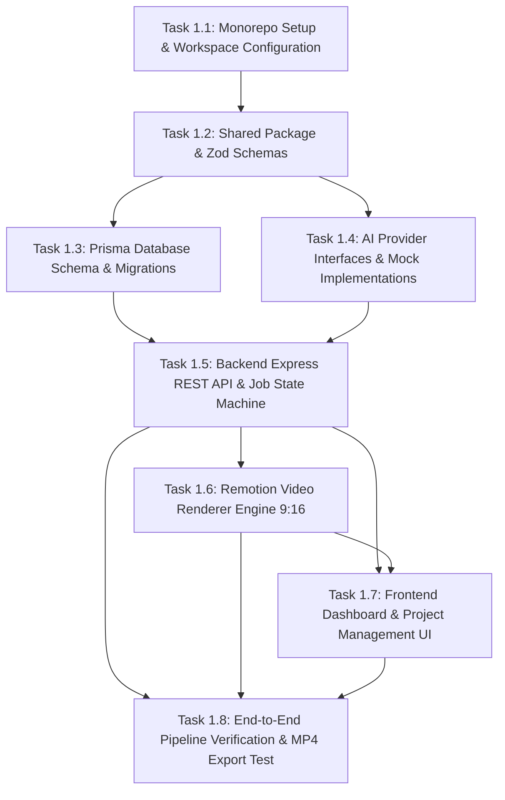

# VietSu AI Studio - Implementation Plan (IMPLEMENTATION_PLAN.md)

## 1. Kế hoạch triển khai Phase 1: Nền tảng (Foundation)

Mục tiêu chính của Phase 1 là dựng hoàn chỉnh cấu trúc Monorepo, Database Schema với Prisma, Dashboard quản lý dự án, REST APIs, Hệ thống AI Provider Interfaces với Mock Providers, Pipeline & Job State Machine, và Remotion Video Renderer xuất được 1 video MP4 1080×1920 thực tế mà **không cần bất kỳ API trả phí nào**.

---

## 2. Phân chia tác vụ chi tiết (Task Breakdown)

---

### Task 1.1: Monorepo Setup & Workspace Configuration
- **Mục tiêu**: Khởi tạo cấu trúc Monorepo với `npm workspaces`, cấu hình TypeScript chuẩn cho toàn bộ dự án (`apps/frontend`, `apps/backend`, `apps/video-renderer`, `packages/shared`, `packages/ai-providers`).
- **Dependencies**: Không.
- **Đầu ra cụ thể**:
  - `package.json` gốc với workspace scripts (`npm run build`, `npm run dev`, `npm run test`).
  - `tsconfig.base.json` cấu hình path aliases và modern ES module support.
  - Cấu trúc thư mục `storage/` (assets, audio, videos, temp) có file `.gitkeep`.
- **Acceptance Criteria**: Chạy `npm install` thành công, các package liên kết nội bộ không báo lỗi module resolution.

---

### Task 1.2: Shared Package & Schemas (Zod)
- **Mục tiêu**: Định nghĩa các kiểu dữ liệu dùng chung (TypeScript types) và schema thẩm định (Zod) cho dữ liệu trao đổi giữa các Agent và giữa Frontend/Backend.
- **Dependencies**: Task 1.1.
- **Nội dung schemas**:
  - `ProjectStatus`: `DRAFT`, `RESEARCHING`, `RESEARCH_PENDING_APPROVAL`, `SCRIPTING`, `SCRIPT_PENDING_APPROVAL`, `GENERATING_ASSETS`, `EDITING`, `QA_CHECKING`, `READY_TO_RENDER`, `RENDERING`, `COMPLETED`, `FAILED`.
  - `HistoricalFactCategory`: `CONFIRMED_FACT`, `HISTORICAL_HYPOTHESIS`, `FOLKLORE_LEGEND`.
  - `HistoricalCitation`: Tiêu đề sách, tác giả, quyển, số trang, đường dẫn xác minh.
  - `ResearchDossier`: Chủ đề, tóm tắt sự kiện, mốc thời gian, nhân vật, danh sách dữ kiện đã kiểm chứng và phân loại.
  - `ScriptDocument`: Hook, thân bài, cao trào, kết luận, số từ, thời lượng ước lượng.
  - `SceneData`: ID, số thứ tự, scriptText, visualPrompt, cameraMotion, durationInFrames, timestamps, assetUrls.
  - `CostRecord`: Provider, service, unitsUsed (tokens/seconds), estimatedCostUSD, estimatedCostVND.
  - `JobStep`: Bước hiện tại, tiến độ %, logs.
- **Acceptance Criteria**: Unit test kiểm tra parse Zod schema với dữ liệu mẫu chuẩn và dữ liệu sai quy cách.

---

### Task 1.3: Prisma Database Schema & Migrations
- **Mục tiêu**: Thiết kế schema cơ sở dữ liệu Prisma cho PostgreSQL, hỗ trợ SQLite linh hoạt cho kiểm thử độc lập nhanh.
- **Dependencies**: Task 1.2.
- **Các Models**:
  - `Project`: Quản lý tiêu đề, mô tả, triều đại/thời kỳ, tỷ lệ khung hình (mặc định 9:16), trạng thái.
  - `ResearchData`: Lưu trữ tài liệu nghiên cứu và trích dẫn sử liệu.
  - `ScriptData`: Lưu trữ kịch bản và cấu trúc phân cảnh.
  - `Scene`: Lưu trữ thông tin từng phân cảnh, prompt ảnh, âm thanh, hiệu ứng.
  - `MediaAsset`: Lưu trữ đường dẫn ảnh, giọng đọc, video clip, metadata.
  - `Job`: Quản lý tiến trình xử lý nền (status, progress, logs, error).
  - `CostLog`: Lưu chi phí tiêu thụ token/giây audio cho từng dự án.
- **Acceptance Criteria**: Sinh mã Prisma Client (`prisma generate`), thực hiện migrations hoặc push schema thành công, kiểm thử CRUD cơ bản với model `Project`.

---

### Task 1.4: AI Provider Interfaces & Mock Implementations
- **Mục tiêu**: Xây dựng kiến trúc Provider tách rời (Decoupled Provider Pattern) và bộ Mock Providers chất lượng cao mô phỏng sát thực tế.
- **Dependencies**: Task 1.2.
- **Interfaces**:
  - `ILLMProvider`: `researchHistory()`, `generateScript()`, `estimateTokens()`.
  - `IImageProvider`: `generateImage()`, `generateHistoricalMap()`.
  - `ITTSProvider`: `synthesizeSpeech()`, `extractWordTimestamps()`.
  - `IVideoProvider`: (Tùy chọn) `animateScene()`.
- **Mock Implementations**:
  - `MockLLMProvider`: Sinh dữ liệu nghiên cứu sử học chân thực về các chủ đề tiêu biểu (*Chiến thắng Bạch Đằng 938*, *Trận Rạch Gầm - Xoài Mút 1785*, *Vua Quang Trung đại phá quân Thanh 1789*) kèm trích dẫn sử liệu có thật (*Đại Việt Sử Ký Toàn Thư*, *Khâm Định Việt Sử Thông Giám Cương Mục*), kịch bản chuẩn cấu trúc 3 hồi.
  - `MockImageProvider`: Sinh ảnh canvas 1080×1920 chất lượng cao với họa tiết hoa văn trống đồng, bản đồ cổ, màu sắc sử thi trang trọng, lưu thành file PNG chuẩn.
  - `MockTTSProvider`: Sinh audio thuyết minh WAV chuẩn có âm sắc hoặc lời đọc rõ ràng kèm bảng word-level timestamps chính xác từng mili-giây.
- **Acceptance Criteria**: Gọi các hàm mock đều trả về dữ liệu tuân thủ 100% Zod schema, lưu file mẫu vào `storage/` cục bộ thành công.

---

### Task 1.5: Backend Express REST API & Job State Machine
- **Mục tiêu**: Xây dựng backend Node.js + Express API quản lý dự án, điều phối pipeline và quản lý job.
- **Dependencies**: Task 1.3, Task 1.4.
- **Endpoints**:
  - `POST /api/projects`: Tạo dự án mới với chủ đề lịch sử.
  - `GET /api/projects`: Danh sách dự án (phân trang, lọc theo trạng thái).
  - `GET /api/projects/:id`: Chi tiết dự án, bao gồm research, script, scenes, assets, jobs, cost.
  - `POST /api/projects/:id/pipeline/start`: Kích hoạt quy trình sản xuất tự động.
  - `POST /api/projects/:id/pipeline/approve-research`: Cổng duyệt sử liệu.
  - `POST /api/projects/:id/pipeline/approve-script`: Cổng duyệt kịch bản & phân cảnh.
  - `POST /api/projects/:id/pipeline/rerun-step`: Chạy lại riêng một bước hoặc một cảnh cụ thể.
  - `GET /api/projects/:id/jobs`: Danh sách jobs và nhật ký realtime log.
  - `POST /api/projects/:id/render`: Kích hoạt tiến trình render Remotion MP4.
  - `GET /api/projects/:id/export`: Tải file MP4 thành phẩm.
  - `GET /api/system/health`: Kiểm tra sức khỏe hệ thống (DB, FFmpeg, Storage).
- **Acceptance Criteria**: Tất cả endpoints hoạt động, xử lý lỗi chuẩn REST, có integration tests kiểm tra toàn bộ luồng REST API.

---

### Task 1.6: Remotion Video Renderer Engine (9:16 Reels)
- **Mục tiêu**: Xây dựng composition Remotion tiêu chuẩn định dạng Facebook Reels (1080×1920, 30fps), hiệu ứng chuyển động Ken Burns và phụ đề động.
- **Dependencies**: Task 1.2.
- **Components Remotion**:
  - `VietSuReel`: Composition gốc nhận props chứa danh sách scenes, audio tracks, citations.
  - `KenBurnsScene`: Hiệu ứng phóng to/thu nhỏ mượt mà bằng CSS `transform: scale() translate()` dựa trên `useCurrentFrame()`.
  - `KineticSubtitles`: Hiển thị phụ đề tiếng Việt với chữ sáng màu vàng kim theo word-level timestamps.
  - `HistoricalWatermark`: Huy hiệu trích dẫn chính sử góc trên thanh lịch.
  - `AudioMixer`: Tích hợp voiceover và background music với ducking.
- **CLI / SSR Renderer Script**:
  - `render-video.ts`: Gọi `@remotion/renderer` để bundle và render ra file MP4 chuẩn H.264/AAC.
- **Acceptance Criteria**: Chạy render từ CLI ra file `.mp4` có kích thước 1080×1920, phát mượt mà, hiển thị phụ đề và hình ảnh đồng bộ.

---

### Task 1.7: Frontend Dashboard & Project Management UI
- **Mục tiêu**: Xây dựng giao diện Web hiện đại bằng React, Vite, Tailwind CSS, hỗ trợ tiếng Việt.
- **Dependencies**: Task 1.5, Task 1.6.
- **Trang & Thành phần chính**:
  - **Header / Navigation**: Logo VietSu AI Studio, trạng thái hệ thống, bộ lọc.
  - **Dashboard**: Danh sách các dự án video, thống kê tổng quan (số video hoàn thành, tổng chi phí ước tính, thời lượng).
  - **Create Project Modal**: Nhập chủ đề, thời đại lịch sử, chọn độ dài (30s/45s/60s), nút gợi ý chủ đề hấp dẫn.
  - **Project Detail View**:
    - *Pipeline Stepper*: Hiển thị tiến trình trực quan 8 bước với trạng thái (Pending, Running, Approval Required, Completed, Error).
    - *Approval Action Bar*: Nút Duyệt nghiên cứu, Duyệt kịch bản, Yêu cầu viết lại.
    - *Research & Citations Tab*: Xem chi tiết dữ kiện, phân loại mức độ tin cậy, nguồn chính sử.
    - *Script & Storyboard Tab*: Xem kịch bản, từng phân cảnh, prompt ảnh, chỉnh sửa lời thoại.
    - *Job & Cost Tracker*: Log chi tiết từng bước, thời gian thực thi, chi phí API tính bằng USD và VND.
    - *Video Player Preview*: Xem trước video hoàn thiện và nút Download MP4.
- **Acceptance Criteria**: Giao diện responsive, kết nối trơn tru với Backend API, thao tác trực quan, báo lỗi rõ ràng.

---

### Task 1.8: End-to-End Pipeline Verification & MP4 Export Test
- **Mục tiêu**: Chạy kiểm thử toàn trình từ tạo dự án, kích hoạt pipeline với Mock Provider, phê duyệt các cổng, sinh tài nguyên, dựng timeline, render ra file MP4 1080×1920 và xác minh video trên ổ cứng.
- **Dependencies**: Tasks 1.1 đến 1.7.
- **Acceptance Criteria**:
  - Dự án mẫu được tạo và lưu vào Database.
  - Pipeline chạy qua các trạng thái thành công.
  - File MP4 được tạo tại `storage/videos/` với kích thước 1080×1920, dung lượng hợp lệ (> 100KB), chạy FFprobe kiểm tra độ phân giải, bitrate và thời lượng chuẩn xác.
  - Báo cáo kết quả kiểm thử đạt 100% tiêu chí.

---

## 3. Kiến trúc Quyết định (Architectural Decision Records - ADR)

### ADR-001: Quản lý Monorepo bằng npm workspaces
- **Bối cảnh**: Cần quản lý đồng thời Frontend (React), Backend (Express), Video Renderer (Remotion) và các thư viện dùng chung.
- **Quyết định**: Sử dụng `npm workspaces` nguyên bản (native npm) vì môi trường hiện tại có `npm v10.9.2` và `Node v22.17.0`, không phụ thuộc thêm công cụ như pnpm hay turborepo chưa cài đặt trên máy.
- **Hệ quả**: Cài đặt và build đơn giản, không phát sinh lỗi thiếu package manager.

### ADR-002: Dual Database Strategy với Prisma (PostgreSQL / SQLite)
- **Bối cảnh**: Hệ thống yêu cầu PostgreSQL cho môi trường sản xuất. Tuy nhiên trong môi trường phát triển cục bộ hoặc chạy test tự động, việc phụ thuộc vào mật khẩu PostgreSQL có thể gây gián đoạn.
- **Quyết định**: Cấu hình Prisma hỗ trợ kết nối PostgreSQL thông qua `DATABASE_URL`, đồng thời cung cấp cấu hình SQLite (`file:./dev.db`) làm cơ chế chạy tức thì không cần cài đặt mật khẩu cho dev/CI.
- **Hệ quả**: Nhà phát triển hoặc reviewer có thể kiểm thử ngay chỉ với một lệnh mà không gặp lỗi cấu hình DB bên ngoài.

### ADR-003: Provider Plugin Interface & Mock Providers
- **Bối cảnh**: Yêu cầu của dự án nhấn mạnh: "Không bịa sự kiện", "Không hardcode API key", "Cho phép chạy pipeline với mock provider khi chưa có API key", "Theo dõi chi phí API".
- **Quyết định**: Tạo thư viện `packages/ai-providers` với các interface trừu tượng (`ILLMProvider`, `ITTSProvider`, `IImageProvider`, `IVideoProvider`). Mọi logic của Agent chỉ phụ thuộc vào Interface. Triển khai `MockProviders` hoàn chỉnh có sẵn cơ sở tri thức sử liệu Việt Nam đã thẩm định, sinh ảnh canvas 9:16 sử thi, sinh audio và word timestamps thực tế.
- **Hệ quả**: Chi phí phát triển và kiểm thử là 0 đồng. Bất kỳ AI API mới nào cũng có thể được bổ sung qua Adapter pattern mà không chạm đến mã nguồn Agent.

### ADR-004: Tích hợp Remotion Rendering trực tiếp
- **Bối cảnh**: Video Facebook Reels cần độ chính xác cao về tỷ lệ (9:16), độ phân giải (1080×1920), phụ đề nhảy chữ nhịp nhàng và hiệu ứng Ken Burns điện ảnh.
- **Quyết định**: Sử dụng Remotion (React for Video) phối hợp cùng FFmpeg. Remotion cho phép lập trình giao diện video bằng React component, tái sử dụng toàn bộ hệ sinh thái UI, tính toán frame theo toán học chính xác.
- **Hệ quả**: Quy trình tạo video hoàn toàn có thể lập trình được bằng code (Video as Code), dễ bảo trì và mở rộng hơn rất nhiều so với script FFmpeg thô.

### ADR-005: Human-In-The-Loop Approval Gates
- **Bối cảnh**: Việc sinh ảnh AI và thuyết minh TTS ngốn phần lớn chi phí và tài nguyên tính toán. Nếu kịch bản sai sử liệu hoặc lời thoại lủng củng, video sinh ra sẽ vô giá trị và lãng phí tiền.
- **Quyết định**: Đặt 2 trạm dừng bắt buộc: Cổng 1 (Research Approval) và Cổng 2 (Script Approval). Chỉ khi người dùng bấm "Phê duyệt" thì hệ thống mới chuyển sang bước sinh tài nguyên.
- **Hệ quả**: Đảm bảo 100% chất lượng nội dung trước khi tốn chi phí API, tuân thủ đúng yêu cầu sản phẩm.
