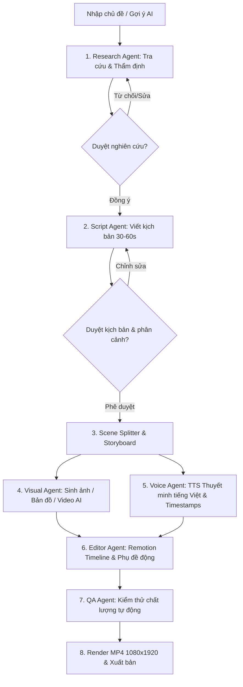

# VietSu AI Studio - Product Specification (PRODUCT_SPEC.md)

## 1. Giới thiệu & Tầm nhìn sản phẩm
**VietSu AI Studio** là nền tảng tự động hóa sản xuất nội dung video ngắn (Facebook Reels, TikTok, YouTube Shorts) chuyên sâu về Lịch sử Việt Nam. Hệ thống kết hợp sức mạnh của nhiều AI Agent chuyên trách (Multi-Agent System) nhằm tối ưu hóa quy trình từ nghiên cứu sử liệu, biên kịch, tạo tài nguyên trực quan/âm thanh, dựng video tự động theo tỷ lệ 9:16 (1080×1920) đến khâu kiểm duyệt chất lượng (QA).

### Giá trị cốt lõi
1. **Tuyệt đối trung thực với lịch sử (Historical Integrity)**: Không bịa đặt nguồn sử học, không tạo dựng hư cấu thành chính sử. Mọi sự kiện đều gắn liền với nguồn sử liệu kiểm chứng và được phân loại minh bạch (Chính sử xác nhận, Giả thuyết khảo cổ/lịch sử, Truyền thuyết dân gian).
2. **Trải nghiệm cuốn hút, định dạng chuẩn Reels**: Video dài 30–60 giây, nhịp điệu nhanh (Hook 3s đầu, cao trào, nút thắt và kêu gọi thảo luận), phụ đề động chuyển động theo từng từ, hiệu ứng camera điện ảnh (Ken Burns zoom/pan).
3. **Kiểm soát chi phí & Human-in-the-loop**: Hệ thống thiết kế các trạm dừng (Approval Gates) để con người duyệt bản nghiên cứu và kịch bản trước khi gọi các API sinh ảnh/giọng nói/video tốn phí. Hỗ trợ Mock Provider giúp kiểm thử toàn bộ pipeline với chi phí 0đ.
4. **Mở rộng linh hoạt (Provider Agnostic)**: Cho phép chuyển đổi linh hoạt giữa các nhà cung cấp AI (OpenAI, Gemini, Claude, Higgsfield, Midjourney/Flux, ElevenLabs, FPT AI, Viettel AI...) mà không thay đổi logic nghiệp vụ lõi.

---

## 2. Đối tượng người dùng & Chân dung người xem
- **Người quản trị nội dung (Creator / Admin)**: Sử dụng Studio Dashboard để nhập chủ đề (ví dụ: *"Chiến thắng Bạch Đằng 938"*, *"Nỏ thần An Dương Vương dưới góc nhìn kỹ thuật đúc đồng"*), kiểm duyệt kịch bản, theo dõi trạng thái render, xem trước cảnh và tải video MP4.
- **Khán giả Facebook Reels**: Giới trẻ, học sinh, sinh viên và cộng đồng yêu thích sử học Việt Nam, đòi hỏi đồ họa hấp dẫn, âm thanh hào hùng, phụ đề sắc nét và tính chuẩn xác cao.

---

## 3. Quy trình sản xuất tự động 8 bước (Pipeline)

### Bước 1: Nghiên cứu và Kiểm chứng sự kiện (Research Agent)
- Tra cứu các nguồn sử liệu đáng tin cậy: *Đại Việt Sử Ký Toàn Thư*, *Khâm Định Việt Sử Thông Giám Cương Mục*, *Việt Nam Sử Lược*, các công trình khảo cổ học của Viện Sử học.
- Phân nhóm dữ kiện:
  - `CONFIRMED_FACT`: Sự kiện có ghi chép chính sử rõ ràng (năm tháng, nhân vật, địa danh).
  - `HISTORICAL_HYPOTHESIS`: Giả thuyết khoa học/khảo cổ đang được tranh biện.
  - `FOLKLORE_LEGEND`: Truyền thuyết dân gian (bắt buộc nêu rõ yếu tố huyền sử).
- Xuất báo cáo nghiên cứu có danh sách trích dẫn (citations) cụ thể.

### Bước 2: Tạo kịch bản kể chuyện 30–60 giây (Script Agent)
- Cấu trúc kịch bản định dạng Reels:
  - **Hook (0-3s)**: Câu hỏi gợi mở hoặc sự thật lịch sử gây bất ngờ.
  - **Context & Escalation (4-25s)**: Diễn biến xung đột, bối cảnh lịch sử, tình thế nguy nan.
  - **Climax (26-45s)**: Trí tuệ chiến thuật, bước ngoặt lịch sử, chiến thắng hoặc bài học.
  - **Resolution & CTA (46-60s)**: Ý nghĩa lịch sử, câu hỏi tương tác để khán giả bình luận.
- Tính toán tổng số từ thuyết minh (tối đa ~120 - 150 từ cho 45-60s tiếng Việt).

### Bước 3: Phân rã cảnh (Scene Storyboarding)
- Mỗi video gồm 4–8 cảnh (mỗi cảnh dài 4–8 giây).
- Mỗi cảnh chứa:
  - `scriptText`: Lời thuyết minh tương ứng.
  - `visualPrompt`: Mô tả chi tiết hình ảnh/bản đồ/trang phục/vũ khí thuần Việt theo đúng niên đại (tránh nhầm lẫn trang phục nhà Thanh hay Tam Quốc).
  - `motionType`: Zoom-in, Zoom-out, Pan-left, Pan-right, Static.
  - `mapLayer`: Tọa độ bản đồ hoặc sơ đồ hướng tiến quân nếu là cảnh diễn biến chiến trận.

### Bước 4: Tạo tài nguyên thị giác (Visual Agent)
- Tạo hình ảnh tĩnh độ phân giải cao tỷ lệ 9:16 (hoặc 16:9 crop có căn chỉnh tiêu điểm).
- Sinh bản đồ chuyển động hoặc vector minh họa lộ trình quân sự cổ.
- (Tùy chọn) Chuyển ảnh thành video clip ngắn bằng Higgsfield API / Runway / Luma.

### Bước 5: Tạo giọng thuyết minh & Căn chỉnh âm thanh (Voice Agent)
- Sinh file âm thanh thuyết minh (WAV/MP3) giọng đọc truyền cảm tiếng Việt (Bắc hoặc Nam hào hùng).
- Trích xuất bảng timestamp chi tiết từng từ (Word-level timestamps) để phục vụ hiệu ứng phụ đề nhảy chữ (Karaoke-style dynamic subtitles).

### Bước 6: Tự động dựng video & Ghép nhạc nền (Editor Agent)
- Remotion Composition chuẩn Reels (1080×1920, 30fps).
- Ghép các layer: Background Visual (Ken Burns motion), Historical Source Watermark, Animated Subtitles, Sound Effects (tiếng trống trận, tiếng ngựa phi, tiếng sóng nước), Background Music (nhạc sử thi).

### Bước 7: Kiểm soát chất lượng (QA Agent)
- Kiểm tra độ khớp giữa thời lượng âm thanh và thời lượng hình ảnh.
- Kiểm tra chính tả tiếng Việt trong phụ đề.
- Kiểm tra tỷ lệ khung hình, viền an toàn (Safe Zone của Facebook Reels để phụ đề không bị nút Like/Share che lấp).
- Đánh giá điểm tổng thể (QA Score >= 85 mới cho xuất bản).

### Bước 8: Xuất video MP4 (Export)
- Render video MP4 chuẩn H.264/AAC với FFmpeg / Remotion SSR.
- Lưu trữ cục bộ trong thư mục `storage/videos/` và cung cấp link tải/xem trước trực tiếp.

---

## 4. Bảng tính năng & Phân loại chi phí API

| Tính năng | Agent phụ trách | Chế độ Mock (Miễn phí) | Chế độ Live (API trả phí) | Ước tính chi phí / Video |
|---|---|---|---|---|
| Nghiên cứu sử liệu | Research Agent | Trích xuất cơ sở dữ liệu mẫu có sẵn (Mock DB) | OpenAI GPT-4o / Claude 3.5 Sonnet / Gemini 1.5 Pro | ~$0.02 - $0.05 |
| Soạn kịch bản & phân cảnh | Script Agent | Kịch bản chuẩn hoá mẫu theo đề tài | OpenAI GPT-4o / Claude 3.5 Sonnet | ~$0.01 - $0.03 |
| Sinh ảnh minh họa cảnh | Visual Agent | Canvas Generator / SVG Map / Mock historical plates | Midjourney API / Flux 1.1 Pro / Recraft AI / DALL-E 3 | ~$0.10 - $0.25 (5-8 ảnh) |
| Video minh họa AI | Visual Agent (Video) | Ken Burns effect trên ảnh tĩnh | Higgsfield API / Runway Gen-3 Alpha | ~$0.50 - $1.00 (tùy chọn) |
| Thuyết minh tiếng Việt & Timestamps | Voice Agent | Giọng đọc Web Speech / Mock Audio Sine Synth + Whisper aligned | ElevenLabs / FPT AI Speech / Viettel AI | ~$0.05 - $0.15 |
| Dựng & Render MP4 | Editor Agent | Remotion + FFmpeg cục bộ trên máy trạm | Remotion + FFmpeg cục bộ (hoặc AWS Lambda Remotion) | $0.00 (Local compute) |
| Kiểm định chất lượng | QA Agent | Rule-based Validator (Regex, durations, safe-zone) | Rule-based Validator + Mini LLM | $0.00 - $0.01 |

> [!IMPORTANT]
> **Quy tắc vàng**: Hệ thống có thể chạy 100% không tốn một đồng chi phí API nào khi sử dụng Mock Provider. Điều này bảo đảm việc phát triển, kiểm thử tự động, CI/CD và demo cho người dùng luôn mượt mà.

---

## 5. Giấy phép thương mại và Pháp lý bản quyền
- **Hình ảnh**: Các mô hình sinh ảnh phải có giấy phép thương mại (Commercial License). Đối với tư liệu sử học từ tranh khắc cổ hoặc bảo tàng, ưu tiên sử dụng tài nguyên thuộc phạm vi công cộng (Public Domain / CC-BY).
- **Phông chữ tiếng Việt**: Sử dụng các phông chữ mở hỗ trợ dấu tiếng Việt đầy đủ (Google Fonts: Montserrat, Be Vietnam Pro, Playfair Display) có giấy phép SIL Open Font License (OFL).
- **Âm nhạc / Âm thanh**: Kho nhạc nền anh hùng ca royalty-free không dính bản quyền Facebook Rights Manager.

---

## 6. Lộ trình phát triển sản phẩm (Roadmap)
- **Phase 1: Foundation (Mục tiêu hiện tại)**:
  - Khung Monorepo (Frontend, Backend, Video Renderer).
  - Database schema Prisma & migrations.
  - Giao diện Dashboard quản lý dự án, chi phí và trạng thái pipeline.
  - Bộ interface AI Provider chuẩn hoá cùng bộ Mock Providers thực thụ.
  - Remotion Video Renderer 1080×1920 với phụ đề và hoạt họa Ken Burns.
  - Xuất thành công video MP4 mẫu độc lập không cần API bên ngoài.
- **Phase 2: Intelligent Multi-Agent Engine**:
  - Tích hợp Live Providers (Gemini/OpenAI cho Research & Script, ElevenLabs/FPT cho Voice, Flux cho Visual).
  - Trạm duyệt Human-in-the-loop (Approve/Reject/Edit inline).
  - Bản đồ động tương tác các chiến dịch lịch sử.
- **Phase 3: Production & Batch Automation**:
  - Hỗ trợ xuất bản hàng loạt, quản lý kênh Facebook Reels.
  - Tích hợp Higgsfield video motion provider.
  - Tối ưu hóa render phân tán trên GPU / Cloud.
